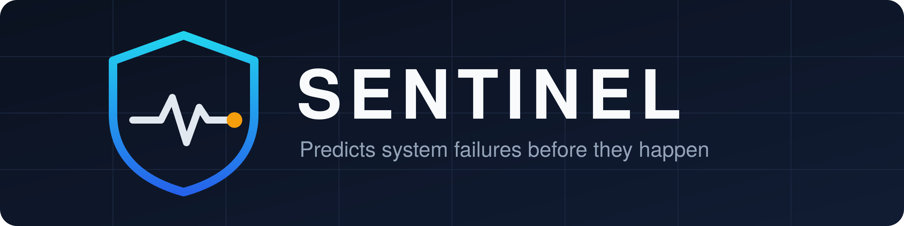

# Sentinel

**A monitoring platform that predicts system failures before they happen.**

Most monitoring tools tell you something broke. Sentinel warns you *before* it breaks — for example:
> "Your database will hit its connection limit in 6 hours."

## How it works

```
App (Spring Boot)  →  Database (PostgreSQL)
        ↓
Metrics (Prometheus)  →  Sentinel (prediction)  →  Alerts (Grafana)
```

## Tech stack

- Java 17, Spring Boot
- PostgreSQL (runs in Docker)
- Coming next: Micrometer, Prometheus, Grafana

## Run it locally

Requirements: Java 17, Docker Desktop

```bash
docker compose up -d
./mvnw spring-boot:run
```

The app runs at `http://localhost:8080`.

## Roadmap

- [x] Spring Boot app connected to PostgreSQL in Docker
- [ ] Orders API (`/orders`)
- [ ] Traffic generator
- [ ] Collect metrics with Micrometer + Prometheus
- [ ] Predict failures (trend lines + anomaly detection)
- [ ] Alerts and Grafana dashboard
- [ ] CI with GitHub Actions
- [ ] Benchmarks: how early failures are caught
